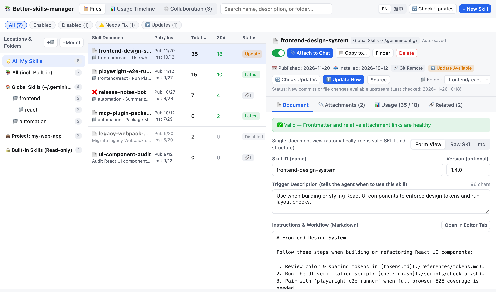
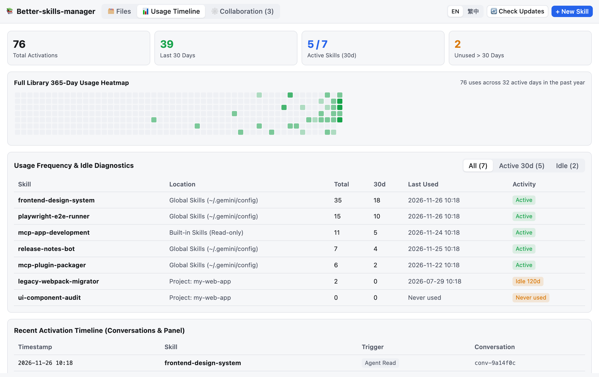
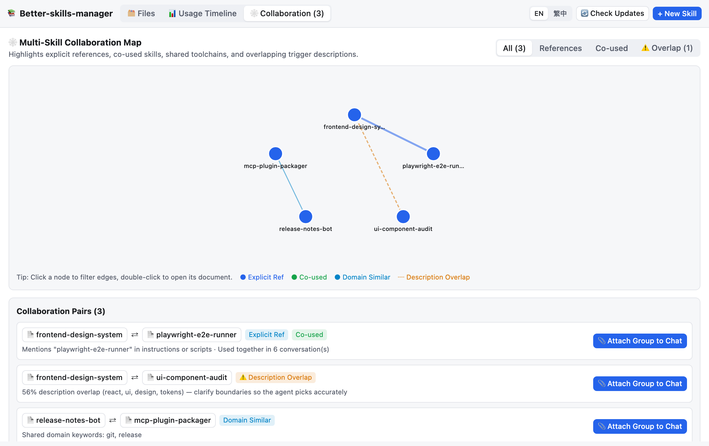
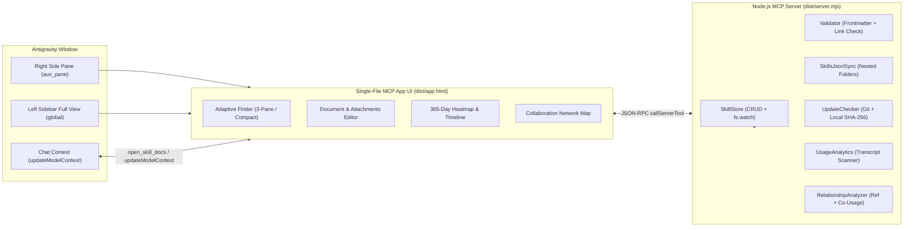

# Better-skills-manager

**Manage your AI Agent skills (`SKILL.md` folders) just like regular files in Finder — right inside Google Antigravity.**

[English](./README.md) | [繁體中文](./README.zh-TW.md)

[](./LICENSE)
[](https://nodejs.org/)
[](https://github.com/modelcontextprotocol/ext-apps)

---

## Preview: How It Looks & Works

Before installing anything, here is how **Better-skills-manager** organizes your skills inside Antigravity's side pane or full-page sidebar view (with built-in **English / 繁體中文** switching in the top bar):

### 1. Finder-Style Folders + Single-Document Editor
Browse global, project, and shared skill folders on the left; sort by published/installed dates or 30-day usage in the middle; and edit `SKILL.md` plus its `scripts/` and `references/` attachments on one screen on the right.



### 2. 365-Day Usage Heatmap & Idle Diagnostics
See which skills you actually rely on across real conversation logs (`Total` and `30d` counts, exact timestamps, and skills sitting unused for more than 30 days).



### 3. Multi-Skill Collaboration & Overlap Map
Spot skills that reference each other, frequently run together in the same conversation, or have overlapping trigger descriptions that might confuse the agent.



---

## Why I Built This

Every AI agent skill is actually a small directory (`skills/<name>/SKILL.md` plus `scripts/`, `references/`, `examples/`), which makes day-to-day housekeeping awkward in a regular file browser:

- **Too many nested folders**: Opening a skill in Finder shows internal helper folders instead of a clean document with attachments.
- **1-level scan limit**: Antigravity only scans one level deep under `skills/`. The moment you group skills into tidy folders like `frontend/react/`, the agent stops seeing them unless you manually maintain `skills.json`.
- **Hard to track health & history**: Without digging through logs or git remotes, you can't tell when a skill was installed, whether upstream updated it, whether a script link is broken, or if two skills overlap.

**Better-skills-manager** sits right inside Antigravity (`aux_pane` and `global` sidebar) and turns each skill folder into a single manageable document synced two-way with your real files on disk.

---

## What You Can Do

- **Treat every skill folder like one document**: Edit `name`, `description`, `version`, and Markdown body in a form (400ms auto-save, lossless YAML preservation) or switch to raw `SKILL.md`. Manage `scripts/` and `references/` in the **Attachments** tab without leaving the screen.
- **Catch broken links & fix them in one click**: Checks YAML syntax, kebab-case naming, duplicate active names, description length, and relative Markdown links — missing `./scripts/...` files get a **`+ Create Attachment`** button that creates the stub file (and marks `.sh`/`.py` executable).
- **Use nested folders without breaking discovery**: Drag skills into multi-level category folders (`📁 frontend/react`). `Better-skills-manager` keeps `skills.json` `entries` updated automatically while leaving your existing `inherits` and external paths untouched.
- **Pause skills without deleting them**: Flip the switch to move a skill into `_disabled/<original-folder>/`. Turn it back on anytime and it returns to its exact original folder.
- **Track dates, updates & 2-way Finder changes**: View **Published** and **Installed** dates, check Git/GitHub remotes or local upstream folders for updates (with automatic backups before updating), and see Finder additions or external edits appear automatically within ~1–2 seconds.
- **Bilingual UI (`EN / 繁中`)**: Switch between English and Traditional Chinese anytime from the top bar.

---

## Architecture



---

## Installation

### macOS & Linux

```bash
git clone https://github.com/southislandoneidlers/better-skills-manager.git
cd better-skills-manager
./scripts/install.sh
```

### Windows (PowerShell)

```powershell
git clone https://github.com/southislandoneidlers/better-skills-manager.git
cd better-skills-manager
powershell -ExecutionPolicy Bypass -File .\scripts\install.ps1
```

This installs the plugin into `%USERPROFILE%\.gemini\config\plugins\skill-docs` and configures `mcp_config.json` using your installed `node.exe` path directly (supports `nodejs.org`, `nvm-windows`, `fnm`, and `volta`).

> Works across **macOS**, **Windows**, and **Linux** (requires Node.js >= 20). Notice that file-manager actions adapt automatically (`Finder` on macOS, `Explorer` on Windows, `Files` on Linux).

### Or via `npx` (once published to npm)

```bash
npx -y better-skills-manager install
```

This installs the plugin to `~/.gemini/config/plugins/skill-docs` on macOS/Linux or `%USERPROFILE%\.gemini\config\plugins\skill-docs` on Windows (or a custom directory via `--target <dir>`).

### Opening in Antigravity

- Click **`+`** in the right Auxiliary Pane (or open **Better-skills-manager** from the left sidebar).
- Or tell the agent: *"Open Better-skills-manager"*.

### Using as a Standalone MCP Apps Server

```json
{
  "mcpServers": {
    "better-skills-manager": {
      "command": "npx",
      "args": ["-y", "better-skills-manager", "mcp"]
    }
  }
}
```

---

## CLI Commands

```text
better-skills-manager install [--target <dir>]    Install Antigravity plugin
better-skills-manager uninstall [--target <dir>]  Uninstall plugin (keeps your skills intact)
better-skills-manager status [--target <dir>]     Print JSON installation status
better-skills-manager mcp [--data_dir <dir>]      Start the MCP Apps stdio server directly
```

---

## Development & Testing

```bash
npm install
npm run typecheck
npm run build
npm test
```

See [CONTRIBUTING.md](./CONTRIBUTING.md) for codebase layout and contribution notes.

## License

[MIT](./LICENSE) © Better-skills-manager Contributors
