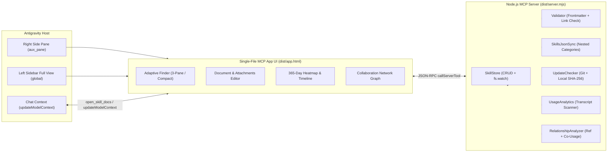

# Skill Docs (`skill-docs`)

**Manage AI Agent `SKILL.md` bundles as intuitively as regular documents — a native MCP App side-pane & full-page Finder plugin for Google Antigravity.**

[English](./README.md) | [繁體中文](./README.zh-TW.md)

[](./LICENSE)
[](https://nodejs.org/)
[](https://github.com/modelcontextprotocol/ext-apps)

---

## Why Skill Docs?

AI agent skills (`skills/<name>/SKILL.md` + `scripts/` + `references/`) are powerful, but managing them in a file explorer feels nothing like managing regular documents:

1. **Multi-file folder sprawl**: Every skill is a directory tree rather than a single document, making edits and attachment inspection tedious.
2. **Flat 1-level scan limits**: Antigravity discovers skills only one directory deep inside `skills/`. Organizing skills into category folders like `frontend/` or `automation/` silently hides them unless you hand-maintain `skills.json`.
3. **Zero lifecycle or usage visibility**: It's hard to tell when a skill was installed or published, whether upstream has updates, how often you actually use it, or which skills collaborate together.

**Skill Docs** solves all three directly inside Antigravity's **Auxiliary Side Pane** and **Left Sidebar Global View**.

---

## Key Features

- **Single-Document Experience + Embedded Attachments**
  - Any folder containing `SKILL.md` is treated as **one document (`📄`)**.
  - Edit `name`, `description`, `version`, and Markdown body in a structured form (with 400ms debounced auto-save and lossless YAML preservation) or toggle raw `SKILL.md` mode.
  - Manage `scripts/`, `references/`, `examples/`, and `resources/` right inside the document's **Attachments** tab, insert relative links in one click, or open natively in Antigravity's `fileView`.
- **Live Linting + 1-Click Broken Link Fix**
  - Continuously checks YAML frontmatter syntax, kebab-case naming, duplicate active names, description completeness, and relative Markdown links.
  - Missing `./scripts/...` or `./references/...` targets show a **`+ Create Attachment`** quick-fix button that generates the stub file (automatically marking `.sh`/`.py` executable).
- **Finder-Style Nested Folders + Safe Archiving**
  - Create arbitrary nested category folders (`📁`) and drag-and-drop skills between them.
  - Automatically reconciles `skills.json` `entries` while **preserving all existing `inherits` and external `entries`**.
  - Toggle skills on/off without deleting files: disabled skills move to `_disabled/<category>/<skill>/` and remember their original folder upon re-enabling.
- **Lifecycle Dates, Update Checks & 2-Way Finder Sync**
  - Displays **Published** and **Installed** dates for every skill.
  - One-click **`🔄 Check Updates`** compares Git/GitHub remotes (`git ls-remote`) or local upstream directories (SHA-256 content fingerprint) and supports **`⬆️ Apply Update`** with automatic pre-update backups (`_backups/`).
  - Real-time `fs.watch` synchronization updates the UI within ~1–2 seconds whenever you drop or edit skills in macOS Finder or your external editor.
- **Usage Frequency & 365-Day Activity Timeline**
  - Incrementally scans local conversation logs (`transcript_full.jsonl`) and panel attaches with 5-minute deduplication.
  - Adds sortable **Total Uses** and **Last 30 Days** columns, idle diagnostics (>30 days unused), a **365-day calendar heatmap**, and exact activation timestamps.
- **Multi-Skill Collaboration & Overlap Graph**
  - Automatically detects relationships across skills via **Explicit References**, **Historical Co-Usage**, **Shared Domain/Tools**, and **⚠️ Trigger Description Overlap Warnings**, with an interactive SVG network graph and one-click group attach to chat.

---

## Architecture



---

## Quick Start

### Option 1: Install via `npx` (npm)

```bash
npx -y skill-docs install
```

### Option 2: Install from Source

```bash
git clone https://github.com/southislandoneidlers/better-skills-manager.git
cd better-skills-manager
./scripts/install.sh
```

> Or on Windows / cross-platform Node:
> ```bash
> npm install && npm run build && node ./dist/cli.mjs install
> ```

This installs the plugin into `~/.gemini/config/plugins/skill-docs` (or a custom directory via `--target <dir>`).

### Opening in Antigravity

- Click **`+`** in the right Auxiliary Pane (or select **Skill 文件庫** in the left sidebar).
- Or ask your Antigravity agent: *"Open Skill Docs"*.

### Option 3: Use as a Standalone MCP Apps Server

Any MCP Apps-compatible host (`SEP-1865`) can launch the server directly:

```json
{
  "mcpServers": {
    "skill-docs": {
      "command": "npx",
      "args": ["-y", "skill-docs", "mcp"]
    }
  }
}
```

---

## CLI Reference

```text
skill-docs install [--target <dir>]    Install Antigravity plugin (default: ~/.gemini/config/plugins/skill-docs)
skill-docs uninstall [--target <dir>]  Uninstall Antigravity plugin (preserves your skills)
skill-docs status [--target <dir>]     Print JSON installation status
skill-docs mcp [--data_dir <dir>]      Start the MCP Apps stdio server directly
```

---

## How Nested Categories & Safe Disabling Work

- **Skill Bundle Detection**: Directories containing `SKILL.md` stop directory traversal so `scripts/` and `references/` remain hidden inside the document's **Attachments** tab.
- **Category Sync (`skills.json`)**: Directories without `SKILL.md` (excluding `.*` and `_*`) act as category folders. Whenever skills live inside nested folders (e.g. `skills/frontend/react/my-skill`), `SkillsJsonSync` registers `skills/frontend/react` in `skills.json` `entries` while keeping any manual `inherits` or external `entries` untouched.
- **Non-Destructive Disable (`_disabled/`)**: Disabling a skill moves it into `skills/_disabled/<original-category>/<skill>/` and removes its managed `skills.json` entry. Re-enabling restores it to its exact original folder.

---

## Development & Testing

```bash
npm install
npm run typecheck
npm run build
npm test
```

See [CONTRIBUTING.md](./CONTRIBUTING.md) for architecture details and contribution guidelines.

## License

[MIT](./LICENSE) © Skill Docs Contributors
