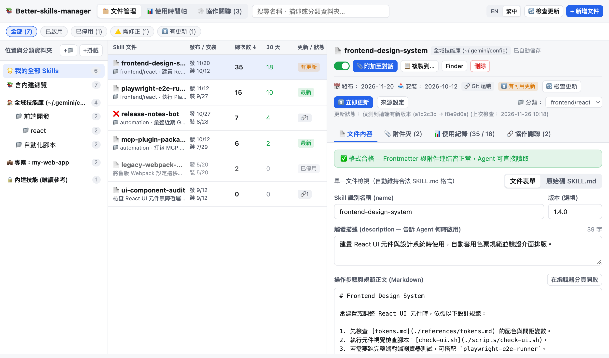
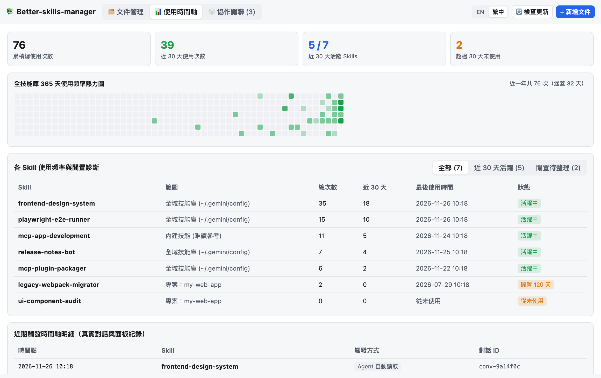
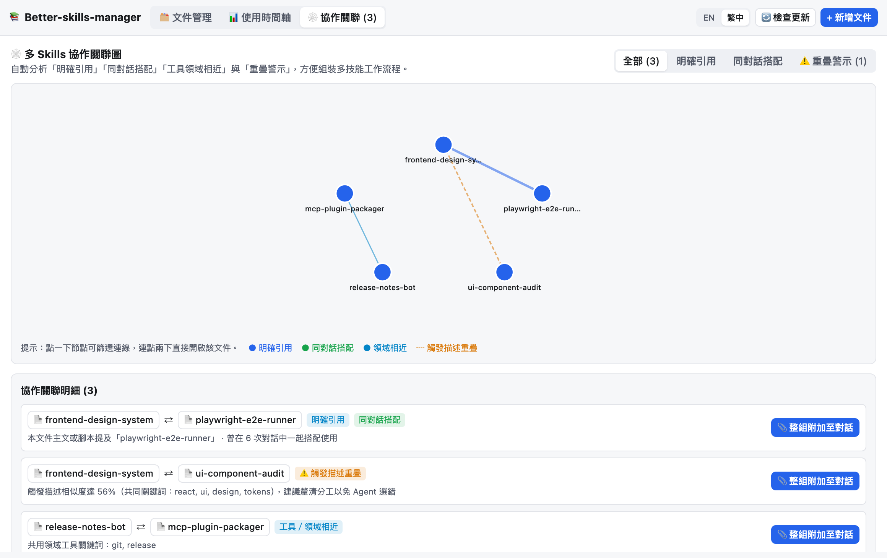
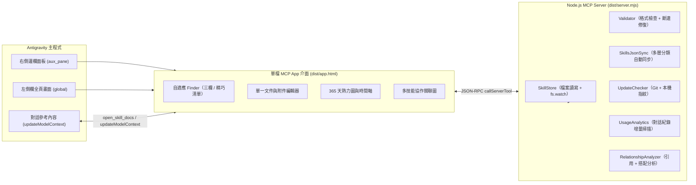

# Better-skills-manager

**讓管理 AI Agent 的 Skills（`SKILL.md` 資料夾）跟在 Finder 管理一般文件一樣順手 —— 專為 Google Antigravity 打造的側邊欄與全頁管理外掛。**

[English](./README.md) | [繁體中文](./README.zh-TW.md)

[](./LICENSE)
[](https://nodejs.org/)
[](https://github.com/modelcontextprotocol/ext-apps)

---

## 介面預覽：實際怎麼管理 Skills？

在安裝之前，先看看 **Better-skills-manager** 在 Antigravity 裡的實際畫面（右上角支援 **`EN / 繁中`** 一鍵切換）：

### 1. Finder 式資料夾分類 ＋ 單一文件編輯器
左邊用熟悉的資料夾分類整理全域、專案與通用目錄的 Skills；中間列表直接顯示發布／安裝日期、總使用次數、近 30 天次數與更新狀態；右邊點開就能直接編輯 `SKILL.md` 與底下的 `scripts/`、`references/` 附件。



### 2. 365 天使用頻率熱力圖 ＋ 閒置診斷
自動掃描本機真實對話紀錄，統計每個 Skill 的累積總次數、近 30 天次數與精確使用時間點，並把超過 30 天沒用到的 Skill 標記出來方便整理。



### 3. 多 Skills 協作關聯圖 ＋ 重疊提醒
自動找出哪些 Skills 會互相點名引用、常在同一輪對話一起搭配使用，或是觸發描述太相近容易讓 Agent 判斷混淆。



---

## 為什麼想做這個工具？

AI Agent 的 Skill 本質上是一個資料夾（`skills/<name>/SKILL.md` 加上 `scripts/`、`references/` 等附屬檔案），但在一般檔案總管裡管理起來並不直觀：

- **每次改內容都要翻好幾層資料夾**：打開資料夾看到的是零散檔案，不像打開一份文件那樣直接讀寫主文與附件。
- **建資料夾分類就會失效**：Antigravity 預設只掃描 `skills/` 底下第一層目錄。只要你像整理文件一樣自己建了 `前端/`、`自動化/` 等分類資料夾，Agent 就會讀不到，除非手動去維護 `skills.json`。
- **看不出使用狀況與更新狀態**：很難一眼確認某個 Skill 什麼時候安裝或發布、遠端有沒有新版、裡面的腳本連結有沒有斷掉，或是過去一年到底有沒有在用。

**Better-skills-manager** 直接整合進 Antigravity 的右側邊欄（`aux_pane`）與左側全頁欄（`global`），把每個 Skill 資料夾包裝成「一份帶附件的獨立文件」，並和本機真實檔案保持雙向同步。

---

## 主要功能

- **把整個 Skill 當成一份文件來讀寫**
  - 只要資料夾內有 `SKILL.md`，在畫面上就是一份獨立文件（`📄`），不會把內部的 `scripts/`、`references/` 展開把左側樹狀清單弄亂。
  - 提供表單編輯（修改後 400ms 自動存檔，且無損保留其他自訂 YAML 欄位）與原始碼切換，同畫面就能打開或新增附件檔案、一鍵插入連結到主文。
- **即時格式檢查 ＋ 斷連一鍵補檔**
  - 編輯時即時檢查 YAML 格式、名稱規範、重複名稱與相對路徑連結；如果主文寫了還沒建立的 `./scripts/setup.sh`，上方會直接跳出 **`+ 一鍵建立此附件`** 按鈕，點一下就建好檔案並補上可執行權限。
- **自由建多層分類資料夾，Agent 照樣讀得到**
  - 像用 Finder 一樣建立 `📁 前端開發/react` 等多層分類資料夾並拖拉歸檔，背景會自動更新 `skills.json` 的 `entries`（**完整保留你原本手動寫的 `inherits` 與外部目錄設定**）。
  - 想暫時停用某個 Skill 時，撥一下開關就會收進 `_disabled/<原分類>/` 封存，不用刪檔；之後重新開啟會自動歸位回原資料夾。
- **發布／安裝時間 ＋ 一鍵檢查更新 ＋ Finder 雙向同步**
  - 列表直接列出每個 Skill 的**發布日期**與**安裝日期**。
  - 點擊 **`🔄 檢查更新`** 會比對綁定的 Git / GitHub 遠端版本或本機來源資料夾指紋，有新版時先自動備份舊版再一鍵更新。
  - 透過檔案系統監聽，在 macOS Finder 直接丟進新 Skill 或用外部編輯器修改內容，1～2 秒內就會自動同步到面板。
- **總次數／近 30 天次數 ＋ 365 天使用時間軸**
  - 增量掃描本機對話紀錄與面板附加紀錄（5 分鐘內重複讀取不會重複灌水），呈現 365 天熱力圖與精確時間點明細。
- **多 Skills 協作關聯圖與中英文切換**
  - 自動列出「明確引用」「同對話搭配」「工具領域相近」與「⚠️ 觸發描述重疊」的 Skills，可一鍵整組附加至對話；右上角隨時切換 **`EN / 繁中`** 介面。

---

## 系統架構



---

## 快速安裝

### 從原始碼安裝

```bash
git clone https://github.com/southislandoneidlers/better-skills-manager.git
cd better-skills-manager
./scripts/install.sh
```

> Windows 或其他跨平台環境請執行：
> ```bash
> npm install && npm run build && node ./dist/cli.mjs install
> ```

### 或透過 `npx` 一行安裝（發佈至 npm 後）

```bash
npx -y better-skills-manager install
```

安裝完成後會自動將外掛部署至 `~/.gemini/config/plugins/skill-docs`（也可以透過 `--target <dir>` 指定其他位置）。

### 如何開啟使用

- 點擊 Antigravity 右側面板右上角的 **`+`** 選單（或左側導覽列），選擇 **「Better-skills-manager」**。
- 或直接在對話裡請 Agent 幫你打開：「幫我打開 Better-skills-manager」。

---

## CLI 指令一覽

```text
better-skills-manager install [--target <dir>]    安裝 Antigravity 外掛
better-skills-manager uninstall [--target <dir>]  移除外掛（會完整保留你的所有 Skills 檔案）
better-skills-manager status [--target <dir>]     以 JSON 顯示目前安裝狀態
better-skills-manager mcp [--data_dir <dir>]      直接以 stdio 模式啟動 MCP Apps Server
```

---

## 開發與測試

```bash
npm install
npm run typecheck
npm run build
npm test
```

想了解專案目錄結構或參與貢獻，歡迎參閱 [CONTRIBUTING.md](./CONTRIBUTING.md)。

## 授權條款

採用 [MIT License](./LICENSE) 開源授權。
