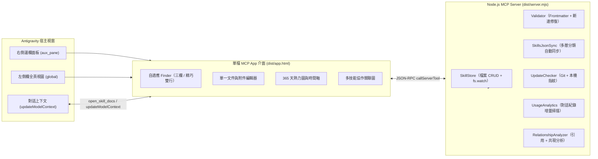

# Skill 文件庫（Skill Docs）

**讓管理 AI Agent 的 Skills 跟在 Finder 管理一般文件一樣簡單 —— 專為 Google Antigravity 打造的原生 MCP App 側邊欄與全頁管理外掛。**

[English](./README.md) | [繁體中文](./README.zh-TW.md)

[](./LICENSE)
[](https://nodejs.org/)
[](https://github.com/modelcontextprotocol/ext-apps)

---

## 為什麼需要 Skill 文件庫？

AI Agent 的 Skill（`skills/<name>/SKILL.md` ＋ `scripts/` ＋ `references/`）本質上是一個資料夾包，因此在一般檔案總管裡管理起來有三大痛點：

1. **多層零散檔案**：每次編輯或檢視腳本、參考資料都要點進好幾層資料夾，不像打開一份文件那樣直觀。
2. **一層掃描限制**：Antigravity 預設只掃描 `skills/` 下一層目錄；一旦自己建了 `前端/`、`寫作/` 等分類資料夾，Agent 就會讀不到，必須手寫 `skills.json`。
3. **缺少使用與更新資訊**：不知道某個 Skill 什麼時候安裝／發布、上游有沒有新版、過去一年到底常用還是已經閒置、以及哪些 Skills 經常協作。

**Skill 文件庫（Skill Docs）** 直接內嵌在 Antigravity **右側邊欄（`aux_pane`）與左側全頁欄（`global`）**，一次解決這三個問題。

---

## 核心功能

- **單一文件化讀寫 ＋ 內嵌附件夾**
  - 所有含 `SKILL.md` 的目錄一律視為**一份獨立文件（`📄`）**。
  - 提供結構化表單（`name`、`description`、`version`、正文）搭配 **400ms 自動存檔**（無損保留其他 YAML 欄位），也可隨時切換原始碼視圖。
  - 同畫面的「**📎 附件夾**」集中讀寫 `scripts/`、`references/`、`examples/` 等附屬檔案，並支援一鍵插入連結到主文或於編輯器分頁開啟。
- **即時格式健檢 ＋ 斷連一鍵修復**
  - 即時檢查 YAML 語法、`name` 命名規範與重複衝突、`description` 必填與字數提醒，以及主文中的相對連結是否斷連。
  - 找不到 `./scripts/...` 或 `./references/...` 檔案時，直接提供 **`+ 一鍵建立此附件`** 按鈕（`.sh`/`.py` 自動加上執行權限）。
- **Finder 式多層分類 ＋ 不刪檔啟停封存**
  - 自由建立多層分類資料夾（`📁`）並拖拉歸檔，背景自動維護 `skills.json` `entries`（**完整保留原有的 `inherits` 與外部 `entries`**）。
  - 一鍵停用自動收進 `_disabled/<原分類>/`，重新啟用立刻歸位原資料夾，不刪檔也不怕 Agent 誤載入。
- **發布／安裝時間 ＋ 更新檢查 ＋ Finder 雙向同步**
  - 列表直接顯示每個 Skill 的**發布日期**與**安裝日期**。
  - 支援一鍵 **`🔄 檢查更新`**（比對 Git / GitHub 遠端 commit 或本機上游目錄 SHA-256 指紋）與 **`⬆️ 立即更新`**（更新前自動備份至 `_backups/`）。
  - 透過 `fs.watch` 監聽本機檔案系統，在 macOS Finder 丟入新 Skill 或外部修改後 1～2 秒自動同步更新。
- **總次數／近 30 天次數 ＋ 365 天使用時間軸**
  - 增量掃描本機對話紀錄（`transcript_full.jsonl`）與面板附加紀錄（5 分鐘去重）。
  - 列表提供可排序的「**總次數**」與「**近 30 天**」欄位，支援 **365 天使用頻率熱力圖**、超過 30 天未使用閒置提醒，以及精確時間點明細表。
- **多 Skills 協作與關聯性自動提示**
  - 自動偵測 **明確引用**、**歷史同對話實戰共現**、**工具領域相近** 與 **⚠️ 觸發描述重疊警示**，並提供互動式 SVG 協作關聯圖與一鍵「**整組附加至對話**」。

---

## 系統架構



---

## 快速安裝

### 方式一：透過 `npx` 一行安裝（發佈至 npm 後）

```bash
npx -y skill-docs install
```

### 方式二：從原始碼安裝

```bash
git clone https://github.com/southislandoneidlers/better-skills-manager.git
cd better-skills-manager
./scripts/install.sh
```

> Windows 或跨平台環境可執行：
> ```bash
> npm install && npm run build && node ./dist/cli.mjs install
> ```

安裝完成後會自動將外掛部署至 `~/.gemini/config/plugins/skill-docs`。

### 如何開啟使用

- 點擊 Antigravity 右側面板右上角的 **`+`** 選單（或左側導覽列），選擇 **「Skill 文件庫」**。
- 或直接在對話中告訴 Agent：「幫我打開 Skill 文件庫」。

---

## CLI 指令一覽

```text
skill-docs install [--target <dir>]    安裝 Antigravity 外掛（預設 ~/.gemini/config/plugins/skill-docs）
skill-docs uninstall [--target <dir>]  移除外掛（完整保留你的所有 Skills 檔案）
skill-docs status [--target <dir>]     以 JSON 顯示安裝狀態
skill-docs mcp [--data_dir <dir>]      直接以 stdio 模式啟動 MCP Apps Server
```

---

## 開發與測試

```bash
npm install
npm run typecheck
npm run build
npm test
```

歡迎閱讀 [CONTRIBUTING.md](./CONTRIBUTING.md) 了解原始碼結構與貢獻方式。

## 授權條款

採用 [MIT License](./LICENSE) 開源授權。
